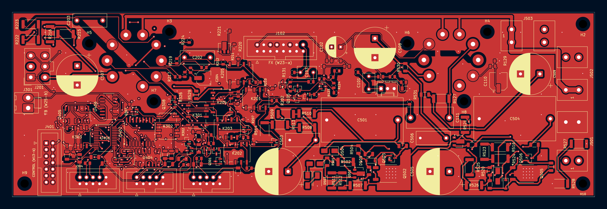
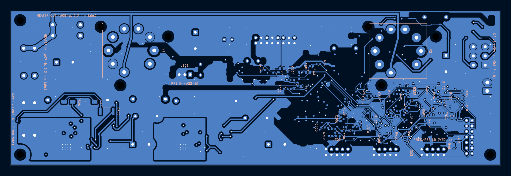
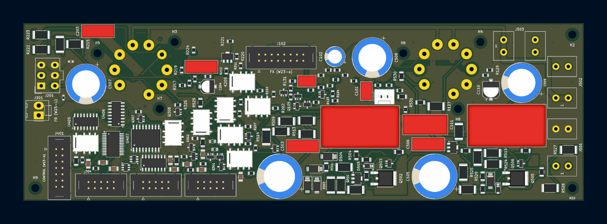
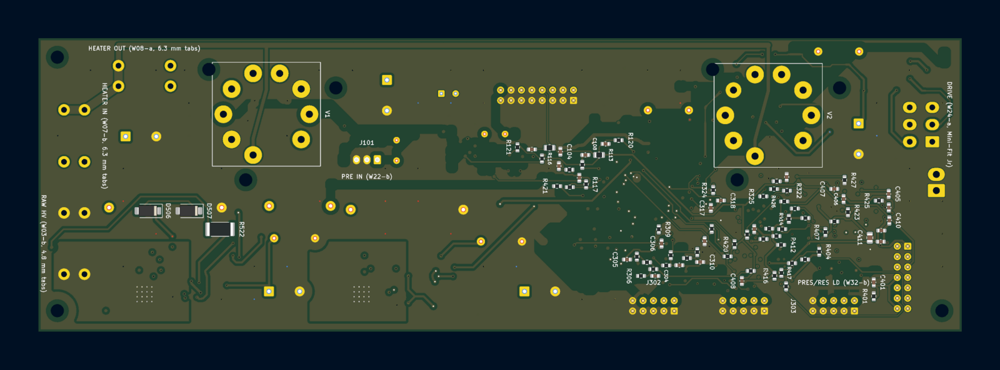
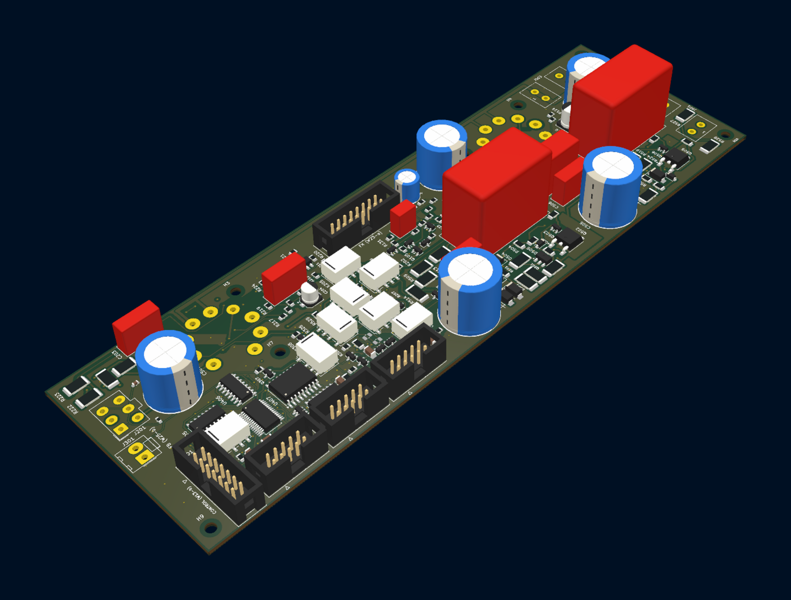

# Board renders

Rendered by CI from `johonkanen/tube_pi_fxloop_kicad` commit [`0b77b446ac`](https://github.com/johonkanen/tube_pi_fxloop_kicad/commit/0b77b446ac5b79dcb2dc1872e636383eb3f512de) on 2026-11-24 21:37 UTC with 10.0.7.
This branch is force-pushed on every render; do not commit to it.

## tube_pi_fxloop_revb (`rev_b/kicad/tube_pi_fxloop_revb.kicad_pcb`)

Copper layers:
- [B_Cu](tube_pi_fxloop_revb/B_Cu.png)
- [F_Cu](tube_pi_fxloop_revb/F_Cu.png)
- [In1_Cu](tube_pi_fxloop_revb/In1_Cu.png)
- [In2_Cu](tube_pi_fxloop_revb/In2_Cu.png)
